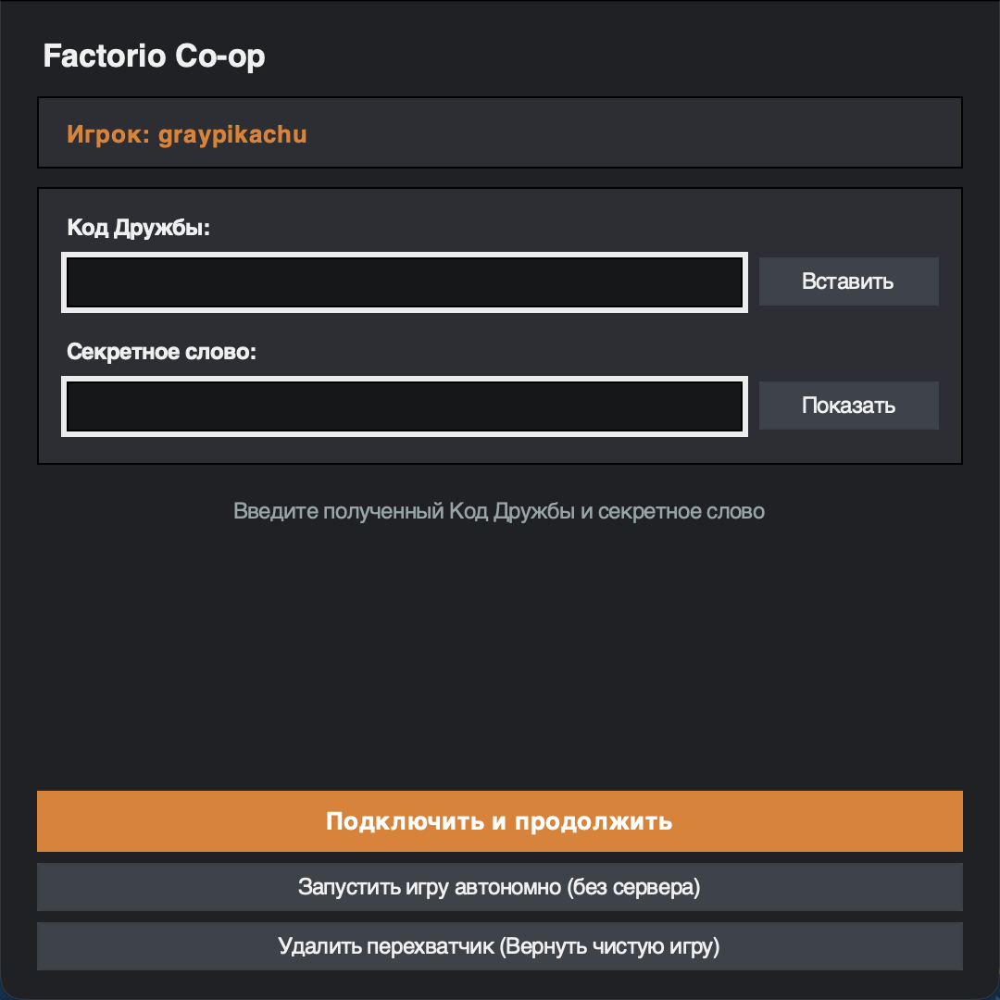
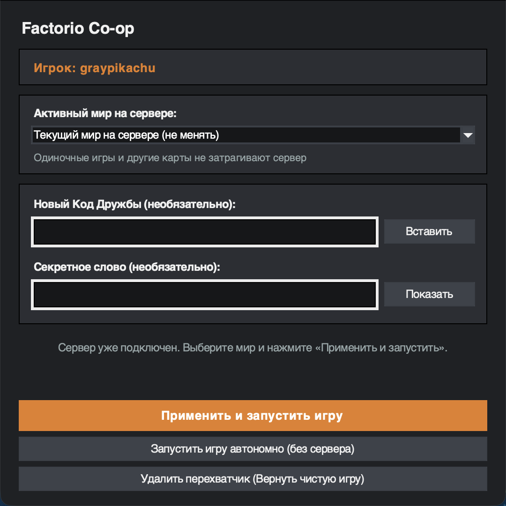
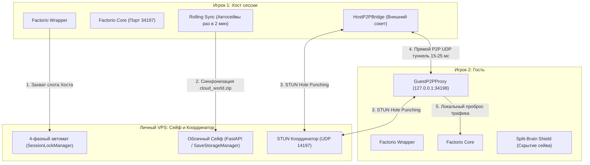

<p align="center">
  
</p>

# Factorio P2P Cloud Sync & Coordinator

<p align="center">
  
  
  
  
  
  
</p>

Децентрализованная система для комфортной кооперативной игры в non-Steam и standalone Factorio без сторонних VPN-утилит (Hamachi, Radmin VPN, Tailscale). Архитектурная концепция «Сейф + Перехватчик» обеспечивает минимальный прямой P2P-пинг между игроками (15–25 мс), автоматическое сохранение общего мира в облачном хранилище на легковесном VPS (< 25 МБ RAM) и абсолютную защиту от конфликтов и рассинхронизации.

## Для кого

Система создана для друзей, которые хотят играть в Factorio в общем мире в любое удобное время:
- Без привязки к компьютеру одного игрока: мир хранится в облаке и доступен любому участнику.
- Без высокого пинга выделенных серверов в Европе или США (120–150 мс): трафик игры идет напрямую между игроками (P2P).
- Без прожорливых headless-серверов: сервер не запускает тяжелый движок Factorio и потребляет считанные мегабайты памяти на недорогом VPS.
- Без сторонних программ и виртуальных адаптеров: запуск происходит через обычный ярлык игры.

## Инфографика и Демонстрация

<table>
  <tr>
    <td width="42%">
      
    </td>
    <td width="58%" valign="center">
      <h3>Темный интерфейс и онбординг по Коду Дружбы</h3>
      <p>При первом запуске поверх игры открывается окно настройки в стилистике Factorio Dark Industrial. Подключение настраивается в один клик без ручного ввода IP-адресов и портов.</p>
      <ul>
        <li>Автоматическое определение никнейма из локального профиля игры</li>
        <li>Зашифрованные одноразовые Коды Дружбы формата <code>FCT1-...</code></li>
        <li>Вставка билета из буфера обмена одной кнопкой</li>
        <li>Автоматическая привязка устройства и бесшумный запуск в дальнейшем</li>
      </ul>
    </td>
  </tr>
</table>

<table>
  <tr>
    <td width="58%" valign="center">
      <h3>Управление миром сервера и запуск по Shift</h3>
      <p>Хотите сменить серверную карту на другое сохранение или запустить одиночную игру? Просто зажмите <code>Shift</code> при запуске игры, чтобы открыть окно управления мирами.</p>
      <ul>
        <li>Выпадающий список локальных сохранений из папки <code>saves/</code></li>
        <li>Безопасная атомарная публикация мира с ротацией резервных копий</li>
        <li>Блокировка конфликтов: сменить мир нельзя, если на сервере уже идет активная игра</li>
        <li>Автономный запуск в один клик для одиночной игры без синхронизации с сервером</li>
      </ul>
    </td>
    <td width="42%">
      
    </td>
  </tr>
</table>

## Архитектурная концепция: Сейф + Перехватчик

Архитектура системы разделяет обязанности между облачным **«Сейфом»-координатором** на VPS и легковесным **клиентским перехватчиком** на компьютерах игроков.



## Ключевые механизмы защиты (Защита от Split-Brain)

**1. Защита от Split-Brain (раздвоения мира)**
- При подключении Гостя файл `saves/cloud_world.zip` физически скрывается во внутренний каталог `saves/.cloud_stash/`. В меню Factorio второй игрок физически не видит этот мир и не может случайно запустить параллельный хост.
- При закрытии игры или выходе Хоста сохранение мгновенно возвращается на свое место.

**2. Четырехфазный автомат сессий (SessionLockManager)**
- `idle`: сервер свободен, сохранение готово к скачиванию.
- `claiming`: предварительная бронь роли Хоста (TTL 180 сек) с отменой при закрытии главного меню.
- `hosting_active`: Хост запустил сетевую игру, сессия удерживается heartbeat-пакетами.
- `uploading_final`: Хост закрыл игру и выгружает итоговый сейв. Подключающиеся друзья ждут завершения загрузки для получения самого свежего мира.

**3. Rolling Sync и защита от несохраненного прогресса**
- В конфигурации Factorio автоматически включается `autosave-interval=2` и `non-blocking-saving=true`.
- Фоновый процесс Хоста регулярно отправляет свежие автосейвы на сервер.
- При выходе из игры система находит самый свежий файл между ручным сохранением и последним автосейвом текущей сессии: ни одна минута прогресса не теряется.

**4. Бесшовная передача эстафеты (Handover)**
- Если Хост закрывает игру, фоновый монитор у Гостя (`GuestHandoverWatcher`) отслеживает освобождение сервера, автоматически скачивает свежий мир и выводит уведомление. Теперь Гость может в один клик запустить игру как новый Хост.

**5. Изоляция одиночной игры и не-серверных карт**
- Перехватчик анализирует логи Factorio в реальном времени (`factorio-current.log`).
- При наступлении события `Loading map` перехватчик проверяет загружаемый файл: если загружается локальная одиночная карта, бронь роли Хоста на сервере мгновенно снимается.
- Автосохранения одиночной игры изолированы и не попадают в облачное хранилище.

#### Как играть в свои личные одиночные миры
- Запустите игру как обычно.
- В главном меню Factorio выберите «Одиночная игра» и загрузите любую личную карту.
- Система автоматически зафиксирует событие `Loading map`, снимет серверную бронь и переведет перехватчик в пассивный режим без синхронизации.
- Также доступен автономный запуск через кнопку «Запустить автономно (без сервера)» в окне настроек.

**6. Повторный вызов окна настроек по зажатой клавише Shift**
- Модуль `shift_detector.py` опрашивает состояние клавиши Shift при запуске игры без ожидания ввода от пользователя.
- Если клавиша зажата, автоматически открывается окно повторной настройки (`FirstRunSetupWindow`).
- Окно также можно вызвать вручную через флаг командной строки `--wrapper-setup`.

#### Выбор активного мира сервера
- В окне настроек доступен выпадающий список `Combobox` со всеми локальными архивами из папки `saves/`.
- Выбранный архив атомарно отправляется на сервер и становится новым общим миром `cloud_world.zip`.

**7. Stealth Mode и Коды Дружбы**
- Все сетевые эндпоинты требуют авторизации токенами устройств (`device_token`).
- Администратор генерирует зашифрованный Код Дружбы `FCT1-...` (PBKDF2-HMAC-SHA256, 100 000 итераций + шифрование AES CTR + HMAC-SHA256). Адрес и порт сервера полностью скрыты от неавторизованного внешнего сканирования.

**8. Живой статус в Telegram и интерактивное управление (Live Status Dashboard)**
- Интегрированный асинхронный сервис Telegram-бота на сервере (`src/server/telegram_bot.py`), потребляющий считанные мегабайты памяти (< 5 МБ RAM).
- Закрепленное живое табло в чате компании: обновляется в реальном времени при входе/выходе игроков, отображает имя Хоста, подключенных Гостей, длительность сессии, версию и размер сохранения.
- **Интерактивный Конструктор Кода Дружбы (`/invite`)**: генерация зашифрованных ключей `FCT1-...` с выбором срока действия (от 15 минут до 30 дней), количества игроков (одноразовый, 2, 5, без лимита) и вводом собственного секретного слова прямо в чате или через команду `/invite <пароль>`.
- **Копирование ключа в один клик**: интеграция нативного механизма Telegram `copy_text` и чистого блока кода `<pre><code>...</code></pre>`, исключающая случайное копирование служебного текста.
- **Ролевая система доступа и управление администраторами (`/admin`)**:
  - `/myid` (или `/id`) — мгновенный просмотр личного Telegram ID с возможностью копирования в один тап;
  - `/admin list` — просмотр списка действующих администраторов сервера с указанием главного владельца;
  - `/admin add` — назначение нового администратора ответом на его сообщение в группе (Reply), по никнейму (`/admin add @username`, если пользователь уже писал в чат) или напрямую по номеру Telegram ID (`/admin add 123456789`);
  - `/admin remove` — отзыв административных прав (с защитой от случайного удаления главного владельца);
  - Строгая изоляция: генерация кодов дружбы, просмотр ключей OpenRouter и изменение настроек разрешены строго доверенным администраторам, тогда как гостям доступен просмотр статуса.
- Интерактивное меню настроек `/settings` с inline-кнопками: переключение уведомлений, выбор режима хроник, создание новых Кодов Дружбы и список администраторов.

**9. ИИ-Хроники Наувиса и автопостинг скриншотов базы (AI Chronicles)**
- Автоматически устанавливаемый легковесный мод `factorio-coop-chronicle`: перехватывает ключевые события игры (гибель инженера от кусак, изучение технологий, запуски ракет, возведение ядерных реакторов).
- Автоматическое создание скриншотов с камеры игрока в светлое время суток (`daytime=0.5`).
- Трехуровневый каскад ИИ-генерации репортажей (`src/server/ai_chronicle.py`):
  - **Tier 1 (OpenRouter Vision):** мультимодальный анализ скриншота базы и телеметрии нейросетью.
  - **Tier 2 (Zero-Key Pollinations):** автоматическая текстовая генерация без необходимости указывать API-ключ.
  - **Tier 3 (Local Template Fallback):** локальный шаблонный генератор при отсутствии связи.
- Ролевые стили публикаций в Telegram-канал: военный корреспондент (`reporter`), бортовой саркастичный ИИ (`ship_ai`) или дружелюбный летописец (`friendly`).

**10. Архивация и сброс мира на сервере**
- В окне управления миром по `Shift` доступна функция сброса текущей карты с автоматическим архивированием на VPS и возможностью локального скачивания копии.

## Стек технологий

<div align="center">
  
  
  
  
  
  <br>
  
  
  
</div>

## Быстрый старт

### Развертывание на VPS

Требования: Ubuntu 22.04+ / Debian 11+, Python 3.10+ (системный пакет python3-venv устанавливается инсталлятором автоматически), свободные порты `8088/tcp` (HTTP API) и `14197/udp` (STUN Coordinator). Порты диапазона `20000:50000` для Hysteria 2 / Xray не затрагиваются и продолжают работать в штатном режиме.

```bash
# Клонирование репозитория на сервере
git clone https://github.com/GreyPikachu/Vaultorio.git /opt/factorio-setup
cd /opt/factorio-setup

# Автоматическая установка и запуск systemd-сервиса (лимит памяти 64 МБ)
sudo ./deploy/vps/install_vps.sh
```

#### Генерация одноразового Кода Дружбы (на 1 раз на 1 час)

Для подключения друга сгенерируйте защищённый одноразовый код на сервере:

```bash
cd /opt/factorio-hub
./venv/bin/python3 -m src.server.admin_cli create-invite --ttl-minutes 60 --max-uses 1 --passphrase "секретное_слово"
```

Параметры команды:
- `--ttl-minutes 60` — время жизни билета: **1 час** (60 минут). По истечении времени код автоматически аннулируется.
- `--max-uses 1` — лимит активаций: **ровно 1 раз** (для одного игрока). Сразу после первой успешной активации код сгорает, а устройство игрока получает постоянный токен доступа.
- `--passphrase "..."` — секретное слово / пароль для расшифровки кода (друг вводит его в окне подключения).
- `--note "Для друга"` *(опционально)* — заметка в журнале авторизаций.

Команда выведет билет вида `FCT1-...`. Передайте этот код и секретное слово вашему другу.

Полезные команды управления доступом на VPS:
```bash
# Просмотр списка выданных инвайтов и активных устройств
./venv/bin/python3 -m src.server.admin_cli list

# Очистка устаревших и использованных билетов
./venv/bin/python3 -m src.server.admin_cli cleanup

# Настройка Telegram-бота (живой статус чата и хроника)
./venv/bin/python3 -m src.server.admin_cli setup-telegram --bot-token "ТОКЕН_БОТА" --chat-id "-100123456789"

# Управление администраторами Telegram-бота через консоль
./venv/bin/python3 -m src.server.admin_cli admin-list
./venv/bin/python3 -m src.server.admin_cli admin-add --user-id 5579762654 --username "@Gray_Pikachu"
./venv/bin/python3 -m src.server.admin_cli admin-remove --user-id 123456789
```

### Установка для игроков (macOS и Windows)

#### Быстрая установка в одну команду (рекомендуется)

Скрипт автоматически найдет установленную Factorio на диске, проверит и при необходимости настроит окружение, загрузит необходимые компоненты и внедрит прозрачный перехватчик в игру:

- **Windows 10 / 11** (PowerShell от имени администратора):
```powershell
irm https://raw.githubusercontent.com/GreyPikachu/Vaultorio/main/deploy/install.ps1 | iex
```

- **macOS** (Терминал):
```bash
curl -fsSL https://raw.githubusercontent.com/GreyPikachu/Vaultorio/main/deploy/install.sh | bash
```

---

#### Полное удаление и возврат к оригинальной игре

- **Windows** (PowerShell от имени администратора):
```powershell
irm https://raw.githubusercontent.com/GreyPikachu/Vaultorio/main/deploy/uninstall.ps1 | iex
```

- **macOS** (Терминал):
```bash
curl -fsSL https://raw.githubusercontent.com/GreyPikachu/Vaultorio/main/deploy/uninstall.sh | bash
```

---

#### Локальная установка через файлы скриптов (если репозиторий уже склонирован)
- **Windows**: дважды щелкните по скрипту `deploy/client/windows/install_windows.bat`.
- **macOS**: дважды щелкните по скрипту `deploy/client/macos/install_mac.command`.

### Как играть

1. Запустите Factorio как обычно (через Launchpad, ярлык или проводник).
2. При первом запуске вставьте полученный Код Дружбы `FCT1-...`, введите секретное слово и нажмите «Подключить».
3. **Если вы зашли первым (Хост)**:
   - Всплывающее уведомление подскажет: `«Вы — Хост! Зайдите в: Сетевая игра -> Запустить сохранённую игру -> cloud_world»`.
   - Запустите игру. Ваш компьютер станет сервером сессии.
4. **Если друг уже играет (Гость)**:
   - Всплывающее уведомление подскажет: `«Сейчас хостит [Имя]! Зайдите в: Сетевая игра -> Прямое подключение -> Подключиться»`.
   - Адрес `127.0.0.1:34198` уже скопирован в буфер обмена. Просто нажмите «Подключиться».
5. **Для возврата оригинальной игры**:
   - Запустите скрипт `uninstall_mac.command` (или `uninstall_windows.bat`). Модификация мгновенно удаляется, полностью возвращая чистую оригинальную Factorio.

## Структура проекта

```text
FactorioSetup/
├── deploy/
│   ├── client/                     # Клиентские скрипты запуска и установки
│   │   ├── macos/                  # install_mac.command, uninstall_mac.command
│   │   ├── windows/                # install_windows.bat, uninstall_windows.bat
│   │   └── requirements.txt        # Клиентские библиотеки (httpx)
│   └── vps/                        # Серверное развертывание
│       ├── factorio-hub.service    # Systemd-сервис с лимитом памяти 64 МБ
│       ├── install_vps.sh          # Скрипт автоматического деплоя
│       ├── requirements.txt        # Серверные библиотеки (FastAPI, Uvicorn)
│       └── uninstall_vps.sh        # Скрипт удаления с VPS
├── docs/
│   └── showcase/                   # Иконка и скриншоты интерфейса
├── src/
│   ├── client/                     # Клиентское ядро перехватчика
│   │   ├── chronicle_mod.py        # Генератор и установщик Lua-мода factorio-coop-chronicle
│   │   ├── chronicle_watcher.py    # Демон отслеживания игровых событий и скриншотов
│   │   ├── config.py               # Параметры клиента и барьеры портов
│   │   ├── factorio_env.py         # Пути игры, Split-Brain Shield, никнеймы
│   │   ├── factorio_wrapper.py     # Точка входа перехватчика
│   │   ├── host_workers.py         # LobbyDetector, Heartbeat, AutosaveWatcher
│   │   ├── hub_client.py           # REST-клиент Сейфа и активация инвайтов
│   │   ├── p2p_tunnel.py           # HostP2PBridge, GuestP2PProxy, STUN
│   │   ├── session_orchestrator.py # SessionOrchestrator, HandoverWatcher
│   │   ├── setup_gui.py            # Dark Industrial GUI (Tkinter / TTK clam)
│   │   ├── shift_detector.py       # Нативный кроссплатформенный детектор Shift
│   │   └── ui_notifier.py          # Всплывающие уведомления и буфер обмена
│   ├── common/                     # Общие криптографические модули
│   │   └── invite_codec.py         # Кодек инвайтов FCT1-... (PBKDF2 + AES + HMAC)
│   ├── installer/                  # Логика инсталлятора и деинсталлятора
│   │   └── installer.py            # FactorioWrapperInstaller
│   └── server/                     # Сервер Сейфа, Telegram и STUN
│       ├── admin_cli.py            # CLI администратора (создание инвайтов, Telegram setup)
│       ├── ai_chronicle.py         # 3-уровневый каскад ИИ-хроники (Vision/Pollinations/Local)
│       ├── ai_model_probe.py       # Зондирование бесплатных Vision-моделей OpenRouter
│       ├── api.py                  # FastAPI REST роутер со Stealth Mode и хуками
│       ├── auth_manager.py         # Управление билетами и токенами устройств
│       ├── config.py               # Конфигурация сервера
│       ├── main.py                 # Точка входа сервера
│       ├── schemas.py              # Pydantic-схемы валидации
│       ├── session_manager.py      # SessionLockManager (4-фазный автомат)
│       ├── storage.py              # SaveStorageManager (атомарное хранилище и сброс)
│       ├── stun_coordinator.py     # UDP STUN координатор (14197/udp)
│       └── telegram_bot.py         # Асинхронный сервис Telegram-бота с Live Dashboard
└── tests/                          # 419 автоматических тестов (модульные, интеграционные и E2E)
```

## Разработка и тестирование

Проект покрыт всесторонним тестовым комплектом из 419 автоматических тестов (включая модульные, интеграционные, E2E-сценарии перехвата, изоляцию одиночной игры, интеграцию с Telegram Bot API, AI Chronicle и валидацию моделей):

```bash
# Активация окружения и запуск тестов
source .venv/bin/activate
pytest tests/ -v
```

## Приватность и Безопасность

- **Zero Telemetry**: Никакие данные не отправляются сторонним серверам или аналитическим сервисам.
- **Zero Open Attack Surface**: Серверные порты защищены обязательной криптографической аутентификацией.
- **Изоляция данных**: Ваши одиночные миры и сохранения надежно изолированы и не покидают компьютер.
